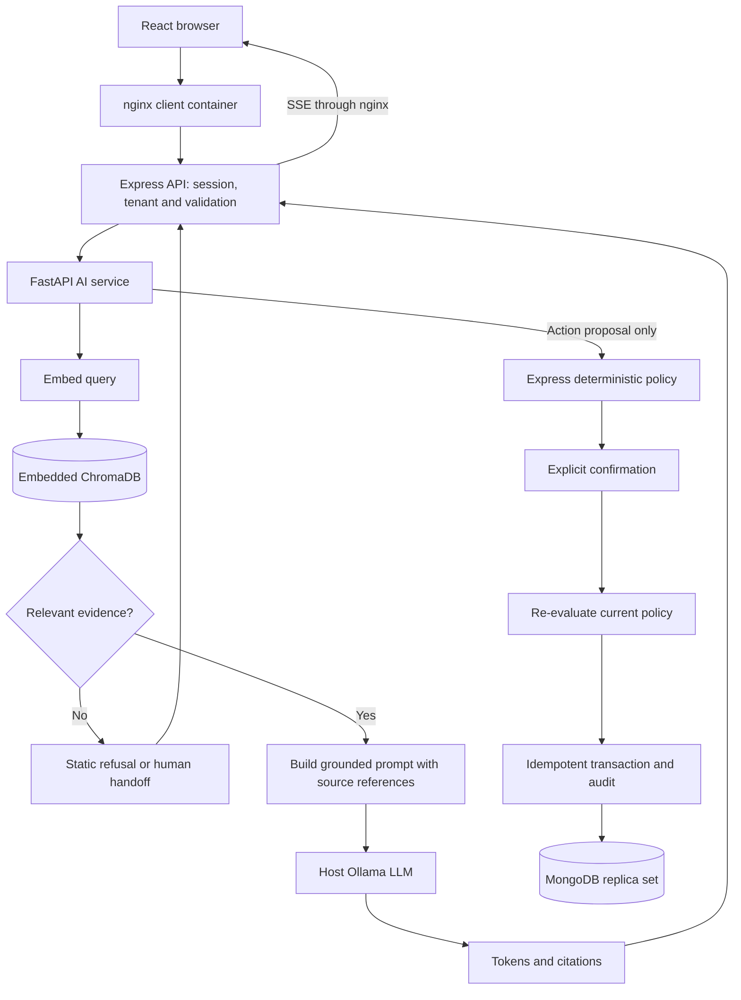
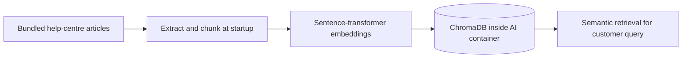

# AI Support Desk

[](https://github.com/Manoj132508/support-desk/actions/workflows/ci.yml)
[](https://github.com/Manoj132508/support-desk/actions/workflows/deploy.yml)
[](https://github.com/Manoj132508/support-desk/actions/workflows/audit.yml)

An AI support assistant that **takes actions with consequences** — and structurally cannot take
one nobody authorised.

The assistant answers customer questions from a help-center knowledge base, looks up real order
data, and can **cancel an order**. That last capability is the point of the project. The
retrieval half is deliberately reused: it is ported from
[Project 1, the AI Knowledge Assistant](https://github.com/Manoj132508/ai-), not rewritten, and
this README will keep saying so. The new engineering is everything between the advisory service
requesting an order cancellation and that cancellation actually happening. Action proposals are
constructed deterministically and bypass the language model.

> **INV-A — the invariant this project exists to demonstrate**
>
> The language model may **propose** an action. It may never **authorise** one. Every
> side-effecting action passes a deterministic policy evaluation *and* an explicit confirmation
> of the exact, fully-resolved action before it executes.

INV-A is not a prompt instruction. If the system prompt were deleted tomorrow, it would still
hold — the AI service simply has no write path to business data. That is what makes it an
architectural property rather than a hope.

---

## Status

**Phase 15 of 17 — deployable.** The reviewed source has **871 passing automated tests**:
586 Express/API tests, 151 React/Vitest tests and 134 FastAPI/pytest tests. The earlier 867
total was stale. All three layers passed both the recorded main-branch CI run and a fresh local
rerun on 26 October 2026; see [Testing & reliability](#testing--reliability) for revisions,
commands, complete logs and limits. CI also evaluates the deterministic policy separately.

The project implements ChromaDB-backed retrieval and a Docker Compose deployment. Its action
reliability comes from policy checks, explicit confirmation, idempotency and tests; running in
containers alone does not guarantee correctness. The AI service reuses retrieval from Project 1.

The badges report separate workflow states. The latest reviewed main-branch
[dependency audit failed](https://github.com/Manoj132508/support-desk/actions/runs/40286850934);
passing functional tests do not imply a clean dependency audit. The existing phase documents
below preserve the implementation history.

### Quick start with Docker Compose

Prerequisites: Docker with Compose, a running host Ollama service, the model named by
`AI_MODEL` (default `llama3.1:8b`), and enough disk/memory for the Python embedding runtime.

1. Copy `.env.compose.example` to `.env` (`cp` in a Unix shell or `Copy-Item` in PowerShell).
2. Set `JWT_SECRET` and `AI_SERVICE_TOKEN` to independently generated values of at least
   32 characters. For a **local HTTP trial only**, set `NODE_ENV=development`; production
   sessions require HTTPS. Keep `.env` private and uncommitted.
3. Pull the chosen Ollama model on the host, then start the application:

   ```bash
   ollama pull llama3.1:8b
   docker compose up --build
   ```

Open <http://localhost:5179>. For the local demonstration, seed the included fake orders and
accounts in a second terminal:

```bash
docker compose run --rm api node scripts/seed.js
```

The seed refuses production mode. See [DEPLOYMENT.md](DEPLOYMENT.md) for the demo accounts,
HTTPS, host-model networking and index reconciliation. `docker compose down` stops the stack;
its named MongoDB volume is retained unless explicitly removed.

**Timing is not promised.** A cold image build installs torch and downloads an embedding
model; the first Ollama model pull also depends on bandwidth and hardware. A three-minute
first-run claim has not been established. Compose starts the application, while the test
commands below run its model-free suites separately.

The [recorded deployment check](https://github.com/Manoj132508/support-desk/actions/runs/35281304071)
built and smoke-tested this source on GitHub's Docker runner. This documentation refresh did
not rerun the heavyweight image/model build locally.

### Testing & reliability

Evidence snapshot: source [`0269b4c`](https://github.com/Manoj132508/support-desk/tree/0269b4c2639f07eb50ba1766df6a19af7a82daa0),
rerun locally on **26 October 2026** with Node 24.19.0 and Python 3.12.14. The CI workflow
uses Node 22 and Python 3.12. Counts are test cases, **not coverage percentages**.

| Layer | Runner | Passed | Failed / skipped | Recorded main CI |
|---|---|---:|---|---|
| Express API and policy contracts | Node test runner | 586 | 0 / 0 | [Server job](https://github.com/Manoj132508/support-desk/actions/runs/35281304010/job/105403628871) |
| React frontend | Vitest | 151 | 0 / 0 | [Client job](https://github.com/Manoj132508/support-desk/actions/runs/35281304010/job/105403629039) |
| FastAPI pipeline | pytest | 134 | 0 / 0 | [AI job](https://github.com/Manoj132508/support-desk/actions/runs/35281304010/job/105403629042) |
| **Total** | **Three runners** | **871** | **0 / 0** | [Complete CI run](https://github.com/Manoj132508/support-desk/actions/runs/35281304010) |

The suites exercise policy decisions, re-checks at execution time, racing confirmations,
tenant isolation, authentication, API contracts, streaming frames, UI confirmation behaviour,
retrieval thresholds and AI-service errors. The API tests use injected repositories; the
pipeline tests use fake embedding/generation implementations. These results do not establish
live-model answer quality, real-MongoDB transaction behaviour or production load capacity.
React Router future-version and React `act` warnings remain visible in the captured output.


The screenshot is the frontend subset. The three job links above and full local output
provide the complete 871-test result; no single Vitest run is presented as all 871.

[Complete local runner output](docs/evidence/local-tests.txt) records the source revision,
commands, exit codes and timings. It contains real output with local checkout paths replaced
by `<repo>`; it is not a simulated terminal screenshot.

Install the lockfile dependencies and the lightweight Python test requirements, then run:

```bash
npm --prefix server ci
npm --prefix client ci
python -m pip install -r ai-service/requirements-test.txt
npm --prefix server test
npm --prefix client test
# From ai-service/:
python -m pytest -q
# From the repository root:
npm --prefix server run eval:policy -- --check
```

To recapture all three runners in one log after those prerequisites:

```bash
node scripts/capture-test-evidence.mjs --python python
```

The [CI workflow](.github/workflows/ci.yml) runs tests, frontend build and policy gates on
main pushes and pull requests. The [deployment workflow](.github/workflows/deploy.yml) builds
the images and tests the real Compose stack; the scheduled dependency audit is separate.

### RAG and action architecture

Retrieval precedes answer generation. ChromaDB is an **embedded persistent client inside the
FastAPI service** (`ai-service/app/pipeline/vector_store.py`), not an extra Compose service.
Ollama runs on the host. Neither Redis nor a separate ChromaDB server is required by this
Compose file.





For a small help centre, the grounded prompt can include the full knowledge base in a stable
order; relevance is still checked first. Above that configured size, the prompt uses retrieved
chunks. Action-request turns bypass model generation and send an advisory proposal to Express.
See [the portfolio evidence walkthrough](docs/portfolio-evidence.md) and
[ADR 0011](docs/adr/0011-prompt-shape-for-prompt-reuse.md).

| Document | |
|---|---|
| [Project brief](docs/project-brief.md) | Why this project, and what it deliberately is not |
| [Phase 1 — Requirements](docs/phases/phase-01-requirements.md) | Invariants, FRs, NFRs, success metrics, traceability |
| [Phase 2 — Architecture](docs/phases/phase-02-architecture.md) | Component and trust view, request flows, failure modes |
| [Phase 3 — Database design](docs/phases/phase-03-database-design.md) | Eleven collections, the policy rule model, indexes, privacy |
| [Phase 4 — UI/UX](docs/phases/phase-04-ui-ux.md) | Screens, the confirmation surface, error affordances, accessibility |
| [Phase 5 — Frontend foundation](docs/phases/phase-05-frontend-foundation.md) | What was ported, what is new, the 39 tests, CI |
| [Phase 6 — API contract](docs/phases/phase-06-api-contract.md) | Endpoints, the error envelope, status mapping, SSE frames |
| [Phase 7 — Database integration](docs/phases/phase-07-database-integration.md) | Eleven models, append-only enforcement, tenancy in the query |
| [Phase 8 — Authentication](docs/phases/phase-08-authentication.md) | Ported session auth, CSRF, roles, and default-on route protection |
| [Phase 9 — KB ingest & AI service](docs/phases/phase-09-kb-ingest-and-ai-service.md) | Retrieval ported from Project 1, grounded answers, the frame allowlist |
| [Phase 10 — The core](docs/phases/phase-10-the-core.md) | The policy engine, propose → confirm → execute, the audit, the conversation screen |
| [Phase 11 — Escalation & tickets](docs/phases/phase-11-escalation-and-ticket-lifecycle.md) | When a person is brought in, the ticket lifecycle, the agent console |
| [Phase 12 — Security & privacy](docs/phases/phase-12-security-and-privacy.md) | Review findings, the OWASP pass on confirm, account deletion, retention |
| [Phase 13 — Evals](docs/phases/phase-13-evals.md) | The policy eval that gates CI, the escalation eval, the tuned threshold |
| [Phase 14 — Performance](docs/phases/phase-14-performance.md) | Time to first token measured, the prompt shape that fixed it, query plans |
| [Phase 15 — Deployment & CI](docs/phases/phase-15-deployment-and-ci.md) | Compose with a replica set, the CSP, indexes as a deploy step, CI that runs the stack |
| [Decision records](docs/adr/README.md) | Eleven ADRs — start with [0002](docs/adr/0002-llm-proposes-never-authorises.md) |

---

## The path an action takes

```
customer message
      │
      ▼
 FastAPI (advisory)      retrieval · intent · drafting · action PROPOSAL
      │                  executes nothing, holds no write credentials
      │  proposal crosses the trust boundary as a REQUEST
      ▼
 Express (consequential) ── policy engine ──▶ refuse ──▶ audit ──▶ escalate
      │                     deterministic,
      │                     no model in path
      ▼
 explicit user confirmation of the resolved action
      │
      ▼
 re-evaluate policy  ──▶ execute (idempotent) ──▶ immutable audit record
```

Two details in that diagram do most of the work:

- **Policy is re-evaluated at execution time**, not just at proposal time. Time passes between
  proposing and confirming; the order may have shipped, or the rule may have changed. Treating
  an authorisation as permanent is the classic time-of-check/time-of-use bug.
- **Refused proposals are kept.** What the assistant requested and was stopped from doing is the
  evidence that the invariant works. Deleting refusals would delete the proof.

---

## Honest scoping

Stated here rather than discovered later:

- **Orders are seeded demo records.** There is no e-commerce integration. The impressive part —
  cancelling an order — is cancelling a fake order through a real authorisation path.
- **Retrieval is ported from Project 1.** It is not new work and is not presented as new work.
- **One side-effecting action** (cancel an order) done completely, rather than several done
  shallowly. The policy engine generalises; the MVP does not exercise that generality.
- **`auto-execute` autonomy tier is modelled but never wired.** Shipping an auto-executing path
  would undercut the invariant this project exists to demonstrate.

---

## Tech stack

Everything here already appears in Projects 1 and 2. No technology was added to look
sophisticated.

React 18 + Vite · Node 22 + Express 5 + Mongoose · MongoDB · Python 3.12 + FastAPI ·
sentence-transformers · provider-neutral LLM (Ollama by default) · Docker Compose ·
GitHub Actions

Ports **5179** client / **4400** API / **8200** AI — chosen so this and both prior projects can
run side by side.

---

## Project series

| | Project | The honesty constraint | What the LLM may not do |
|---|---|---|---|
| 1 | [AI Knowledge Assistant](https://github.com/Manoj132508/ai-) | Grounded answers, honest refusal | Answer beyond the retrieved evidence |
| 2 | [AI Career & ATS Platform](https://github.com/Manoj132508/ai-career-platform) | No fabricated credentials | Score, judge, or invent a claim |
| 3 | **AI Support Desk** *(this repo)* | No unauthorised action | Authorise anything with a consequence |

*Saying → phrasing → doing.* Each project takes the same discipline one step further in
consequence.

---

## Licence

MIT
