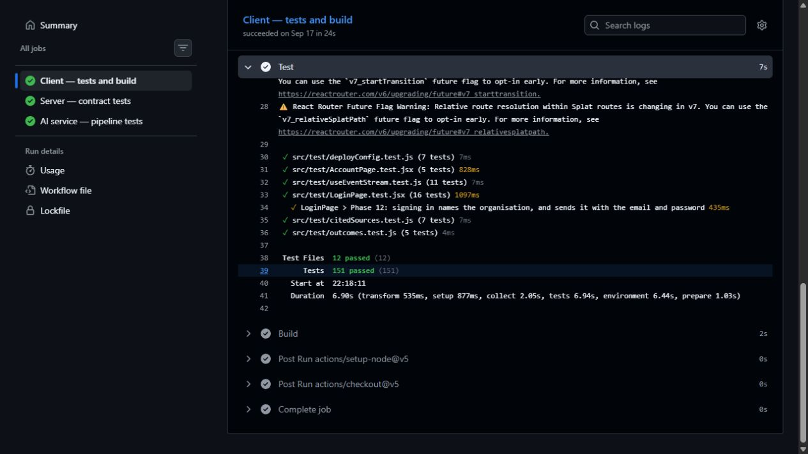

# AI Support Desk - architecture and reproducibility evidence

Reviewed 26 October 2026 against source revision
`0269b4c2639f07eb50ba1766df6a19af7a82daa0`.

## Engineering contribution

Built a RAG-based support application with React, Express, FastAPI and ChromaDB-backed
contextual retrieval. Orchestrated the client, API, AI service and MongoDB replica set using
Docker Compose. Implemented deterministic policy decisions, explicit confirmation,
execution-time re-checks and idempotent actions. Verified **871 automated test cases** across
frontend, API and AI-service layers at this revision.

The earlier 867 total was out of date: the recorded main CI logs and the new local run both
contain 586 API, 151 frontend and 134 AI-service passing cases. This is test-count evidence,
not a code-coverage or universal-reliability claim.

## Service boundaries

| Service | Responsibility | Network/data boundary |
|---|---|---|
| `client` | nginx serves the built React app and proxies `/api` | Only published service, port 5179 by default |
| `api` | Authentication, tenant access, business policy, confirmations, audit and order writes | Internal Express service; owns MongoDB access |
| `ai` | Embed, retrieve, construct context, stream answer or propose an action | Internal FastAPI service; no MongoDB credentials |
| `mongo` | Orders, users, policy, tickets and transactional audit | Internal replica set with named persistent volume |
| `mongo-init` | Initialise replica set | One-shot dependency |
| `indexes` | Reconcile declared indexes before API starts | One-shot deployment step |
| Host Ollama | Run the language model | Reached from AI container through `host.docker.internal` |

ChromaDB runs as an embedded `PersistentClient` in the `ai` process. The index is derived
from the bundled articles and rebuilt on container startup. It is not a separately networked
ChromaDB container. The stack has no Redis dependency.

## Request flow

1. The browser sends a customer message through nginx to Express.
2. Express authenticates the session and establishes the tenant/customer context.
3. FastAPI embeds the question, queries ChromaDB and checks relevance.
4. An ungrounded answer turn produces a static refusal/handoff; it does not call the LLM.
5. A grounded answer turn constructs source context and calls host Ollama; tokens and
   citations stream back through Express and nginx.
6. An action request follows a different path: FastAPI proposes, Express evaluates policy,
   the customer explicitly confirms, and Express re-checks current policy before an
   idempotent MongoDB transaction. The model cannot authorise or execute a write.

The small-help-centre prompt uses a fixed full-context layout after relevance checking;
larger knowledge bases use the top retrieved chunks. See `ai-service/app/service.py`.

## Actual Compose wiring

The following excerpt comes from [`docker-compose.yml`](../docker-compose.yml). It shows
the internal service URL and shared service-token variable, not a real secret value:

```yaml
services:
  ai:
    build: ./ai-service
    environment:
      AI_ENVIRONMENT: production
      AI_SERVICE_TOKEN: ${AI_SERVICE_TOKEN:?set AI_SERVICE_TOKEN in .env (at least 32 characters)}
      AI_OLLAMA_BASE_URL: ${AI_OLLAMA_BASE_URL:-http://host.docker.internal:11434}
      AI_MODEL: ${AI_MODEL:-llama3.1:8b}

  api:
    build: ./server
    environment:
      MONGODB_URI: mongodb://mongo:27017/ai-support-desk?replicaSet=rs0
      AI_SERVICE_URL: http://ai:8200
      AI_SERVICE_TOKEN: ${AI_SERVICE_TOKEN:?set AI_SERVICE_TOKEN in .env (at least 32 characters)}
      TRUST_PROXY_HOPS: "1"
    depends_on:
      indexes:
        condition: service_completed_successfully
      ai:
        condition: service_started

  client:
    build: ./client
    ports:
      - "${CLIENT_PORT:-5179}:80"
    depends_on:
      api:
        condition: service_healthy
```

This is a selected excerpt, not a standalone replacement Compose file. The complete file
also defines the replica set, initialisation, indexes, JWT configuration, volumes and
shutdown settings. No credentials are committed.

## Reproducibility

After installing Docker/Compose, configuring the two secrets in `.env`, and preparing the
host Ollama model, the application entry point is:

```bash
docker compose up --build
```

For a localhost HTTP demo, set `NODE_ENV=development` and seed the demo records as described
in [DEPLOYMENT.md](../DEPLOYMENT.md). Use HTTPS for production session cookies. Startup time
depends on downloaded images/models, hardware and cache state; a sub-three-minute cold
start or full-test promise has not been measured.

## Test and CI evidence



This screenshot shows the frontend portion; the source-linked API and Python jobs below
and complete local output establish the combined 871 passes.

| Evidence | Exact source |
|---|---|
| Fresh complete local test output, 871 passes | [local-tests.txt](evidence/local-tests.txt) |
| Same source, CI tests and policy gate | [main CI run 35281304010](https://github.com/Manoj132508/support-desk/actions/runs/35281304010) |
| API runner, 586 passes | [Server test job](https://github.com/Manoj132508/support-desk/actions/runs/35281304010/job/105403628871) |
| Vitest, 151 passes | [Client test job](https://github.com/Manoj132508/support-desk/actions/runs/35281304010/job/105403629039) |
| pytest, 134 passes | [AI-service test job](https://github.com/Manoj132508/support-desk/actions/runs/35281304010/job/105403629042) |
| Compose image build and smoke test | [main deploy check 35281304071](https://github.com/Manoj132508/support-desk/actions/runs/35281304071) |
| Separate dependency-security status | [main audit 40286850934 - failed](https://github.com/Manoj132508/support-desk/actions/runs/40286850934) |

The tests use injected repositories and model fakes; the Compose smoke test checks real
service startup without a live Ollama answer. Automated tests do not establish production
traffic capacity, complete code coverage or answer quality against arbitrary documents.
